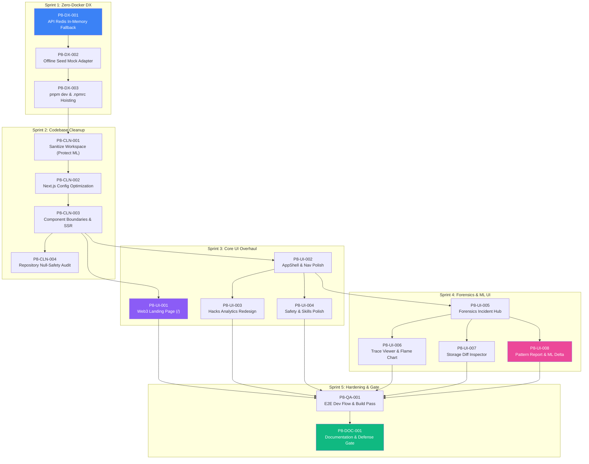

# Phase 8: Platform Stabilization, Zero-Docker DX & UI Refinement — Code Review & Kanban Tasks

> **Project**: AltFlex AEGIS v3.0 — Adaptive Exploit & Governance Intelligence System  
> **Timeline**: Week 41–45 (November 1, 2026 – November 30, 2026)  
> **Priority**: Critical — Platform stabilization, frictionless local execution, and user interface completion for thesis defense  
> **Tech Stack**: Next.js 15/16, React 19, Fastify 5, TypeScript 5.4, Turborepo, ONNX Runtime, Recharts, TanStack Virtual, CSS Modules  
> **Blocked By**: Phase 6 (Production Hardening) ✅ Complete | Phase 7 (ML Integration) ✅ Complete  
> **Implementation Plan**: [`phase8-implementation-plan.md`](file:///C:/Users/flexycode/.gemini/antigravity/brain/9c5a0a5c-0d4d-4bae-8e28-c597d5890129/phase8-implementation-plan.md)  
> **Thesis Alignment**: Chapters 1–5 (Exploit Analytics, Forensic Simulation, and ML Exploit Pattern Classification)

---

## Overview

Following the successful implementation of the core domain engines, database migrations, and the Phase 7 XGBoost/ONNX multi-label exploit pattern recognizer, Phase 8 addresses operational friction and UI maturity before academic defense and demonstration.

Historically, running the local development environment required a running Docker daemon orchestrating PostgreSQL and Redis. Any disruption to Docker or local services caused the Fastify API Gateway to crash or flood stdout with `ECONNREFUSED` connection retry spam. In addition, the frontend experienced Next.js 15/16 client-side fallback warnings, hydration mismatches, and route discrepancies against the specifications in [README.md](../../README.md) (such as a missing public landing page and incomplete forensic views).

**Phase 8 establishes a streamlined developer workflow and production-grade interface through five pillars:**

1. **Zero-Docker Local Developer Experience (DX)**: Enable `pnpm dev` or `npm run dev` to launch the full platform immediately without requiring Docker Desktop, falling back smoothly to in-memory rate limiting and seed mock data if PostgreSQL or Redis are offline.
2. **Codebase Sanitation & Flow Optimization**: Audit the workspace, prune obsolete and flow-breaking files, resolve Next.js build issues, and strictly preserve all ML training scripts, datasets, and ONNX models.
3. **Web3 User Interface Redesign**: Deliver the 5 key UI experiences promised in the documentation:
   - Dedicated Public Landing Page (`/`) with live exploit stats and architecture highlights.
   - Exploit Analytics Dashboard (`/hacks`) with rich time-series charts, vector distribution, and virtualized tables.
   - Dedicated Forensics Hub (`/forensics`) cataloging simulated exploit incidents.
   - Interactive Trace Viewer & Gas Flame Chart (`/forensics/[id]`).
   - Storage Diff Inspector & Exploit Pattern Report featuring the Phase 7 XGBoost ML vs. Heuristic score delta ($\Delta = +0.26$ Macro F1).
4. **API Reliability & Schema Safety**: Ensure complete null-safety mapping across all PostgreSQL repositories and provide standardized error responses.
5. **Quality Assurance & Defense Readiness**: Validate end-to-end builds, tests, and documentation to prepare the codebase for academic review and production demonstration.

---

## Task Breakdown

---

### P8-DX-001: Graceful Redis Degradation for API Gateway

**Title**: Implement Auto-Fallback to In-Memory Rate Limiting when Redis is Unavailable

| Field           | Value                                      |
| :-------------- | :----------------------------------------- |
| Priority        | P0 — Critical                              |
| Estimated Hours | 4                                          |
| Dependencies    | None                                       |
| Assigned Agent  | `senior_backend_engineer`                  |
| QA Agent        | `senior_sdet`                              |
| Review Agent    | `senior_code_reviewer`                     |
| Labels          | `dx`, `api-gateway`, `redis`, `resilience` |

**Description**:
Currently, `apps/api-gateway/src/server.ts` instantiates `new Redis(getRedisUrl(), { maxRetriesPerRequest: null })` unconditionally. When Redis is not running locally, `ioredis` emits unhandled `ECONNREFUSED` error events in an infinite loop, polluting stdout.
Refactor the rate-limiting initialization to probe Redis connectivity with a quick timeout. If Redis is unreachable or `REDIS_URL` is omitted, cleanly fall back to Fastify's native in-memory rate-limiter store and log a single informational notice (`[RateLimit] Redis unavailable; falling back to in-memory store`).

**Acceptance Criteria**:

- [x] Redis connection failure does not crash the API gateway or emit repetitive unhandled error loops.
- [x] Fastify `@fastify/rate-limit` smoothly operates with an in-memory cache when Redis is offline.
- [x] When Redis is active (e.g. in staging or Docker), Redis-backed rate limiting continues to function as before.
- [x] Health check endpoint (`GET /api/v1/health`) reports Redis status as `degraded` or `offline` without returning HTTP 500.

---

### P8-DX-002: Offline Hybrid Mock / Seed Fallback for Data Layer

**Title**: Support In-Memory Mock Fallback for Repositories during Offline Local Development

| Field           | Value                                    |
| :-------------- | :--------------------------------------- |
| Priority        | P0 — Critical                            |
| Estimated Hours | 6                                        |
| Dependencies    | None                                     |
| Assigned Agent  | `senior_backend_engineer`                |
| QA Agent        | `senior_sdet`                            |
| Review Agent    | `senior_code_reviewer`                   |
| Labels          | `dx`, `database`, `offline-mode`, `seed` |

**Description**:
Running without Docker means developers without a local PostgreSQL daemon cannot query `/api/v1/hacks` or `/api/v1/skills`.
Create an in-memory / JSON fallback adapter that satisfies `IHackRepository` and `ISkillRepository`. When the PostgreSQL pool fails to connect on boot, the API gateway logs a warning and populates memory from the existing JSON seeds (`packages/core/src/database/seeds/`).

**Acceptance Criteria**:

- [ ] API gateway probes database connection on boot with a 2-second timeout.
- [ ] If PostgreSQL is reachable, standard `PostgresHackRepository` and `PostgresSkillRepository` are used.
- [ ] If PostgreSQL is unreachable, `InMemoryHackRepository` and `InMemorySkillRepository` are loaded from seed fixtures.
- [ ] `GET /api/v1/hacks` and `GET /api/v1/skills` return 200 OK with valid seed data even when PostgreSQL is stopped.
- [ ] Clear startup log indicates whether running in `PostgreSQL-connected` or `Offline-Seed-Fallback` mode.

---

### P8-DX-003: Monorepo Dev Script Optimization & Windows PNPM Configuration

**Title**: Streamline `pnpm dev` Scripts and Windows PNPM Hoisting

| Field           | Value                                |
| :-------------- | :----------------------------------- |
| Priority        | P1 — High                            |
| Estimated Hours | 3                                    |
| Dependencies    | None                                 |
| Assigned Agent  | `senior_devops_engineer`             |
| QA Agent        | `senior_sdet`                        |
| Review Agent    | `senior_code_reviewer`               |
| Labels          | `dx`, `pnpm`, `windows`, `turborepo` |

**Description**:
Optimize root configuration for cross-platform execution (specifically Windows PowerShell). Create root `.npmrc` with appropriate hoisting settings (`shamefully-hoist=true`) to avoid node resolution issues with symlinks on Windows. Ensure `pnpm dev` starts the required developer services concurrently with clear console formatting.

**Acceptance Criteria**:

- [ ] Root `.npmrc` created and configured for clean Windows PNPM module resolution.
- [ ] `pnpm dev` launches `@aegis/web` (port 3000) and `@aegis/api-gateway` (port 4000) cleanly via Turborepo.
- [ ] Environment variable discovery in `.env` is loaded automatically across all child packages without path errors.
- [ ] Clear documentation in `README.md` for zero-Docker startup.

---

### P8-CLN-001: Workspace File Sanitation & Redundancy Pruning

**Title**: Audit Workspace and Remove Flow-Breaking Files while Safeguarding ML Assets

| Field           | Value                                       |
| :-------------- | :------------------------------------------ |
| Priority        | P1 — High                                   |
| Estimated Hours | 4                                           |
| Dependencies    | None                                        |
| Assigned Agent  | `senior_software_engineer`                  |
| QA Agent        | `senior_sdet`                               |
| Review Agent    | `senior_code_reviewer`                      |
| Labels          | `cleanup`, `refactoring`, `ml-preservation` |

**Description**:
Conduct a thorough audit of all packages and apps to identify orphaned imports, stale temporary files, and redundant configs that disrupt development workflows.
**CRITICAL MANDATE**: All ML training scripts, datasets, notebooks, and models in `research/` and `scripts/ml/` must be protected and preserved.

**Acceptance Criteria**:

- [ ] Identify and prune dead or unreferenced files that cause TypeScript or build errors.
- [ ] Verify that `research/datasets/augmented_labels.json`, `research/models/*.onnx`, and `scripts/ml/*.py` are completely preserved.
- [ ] Clean up redundant type declaration overrides and obsolete scratch files.
- [ ] `pnpm lint` and `pnpm typecheck` pass without dead-module errors.

---

### P8-CLN-002: Next.js Configuration Refinement & Bundle Optimization

**Title**: Optimize `next.config.ts` and Eliminate Excessive Client Fallbacks

| Field           | Value                                          |
| :-------------- | :--------------------------------------------- |
| Priority        | P1 — High                                      |
| Estimated Hours | 4                                              |
| Dependencies    | P8-CLN-001                                     |
| Assigned Agent  | `senior_frontend_engineer`                     |
| QA Agent        | `senior_sdet`                                  |
| Review Agent    | `senior_code_reviewer`                         |
| Labels          | `nextjs`, `webpack`, `bundling`, `performance` |

**Description**:
Currently, `apps/web/next.config.ts` includes extensive webpack fallbacks (`fs: false`, `net: false`, `pg: false`, `ioredis: false`, etc.) because some server-side modules were accidentally leaked into client-side imports.
Refactor imports so that server modules are strictly encapsulated in React Server Components or server actions. Streamline `next.config.ts` to improve build speed and remove unnecessary polyfills.

**Acceptance Criteria**:

- [ ] Isolate Node.js built-ins to server-only files.
- [ ] Simplify `apps/web/next.config.ts` webpack configuration while maintaining support for `@aegis/core` transpilation.
- [ ] Eliminate client-side bundling warnings during `pnpm --filter @aegis/web dev` and `pnpm --filter @aegis/web build`.
- [ ] Ensure API rewrites `/api/:path*` -> `http://localhost:4000/api/:path*` work reliably in both dev and production modes.

---

### P8-CLN-003: Server vs. Client Component Harmonization & Hydration Fixes

**Title**: Standardize Component Boundaries and Eliminate Hydration Errors

| Field           | Value                                   |
| :-------------- | :-------------------------------------- |
| Priority        | P1 — High                               |
| Estimated Hours | 4                                       |
| Dependencies    | P8-CLN-002                              |
| Assigned Agent  | `senior_frontend_engineer`              |
| QA Agent        | `senior_sdet`                           |
| Review Agent    | `senior_code_reviewer`                  |
| Labels          | `nextjs`, `react19`, `ssr`, `hydration` |

**Description**:
Dashboard views currently exhibit mixed component paradigms (some pages fetch directly in client components with SWR while others use server components). Ensure clear separation between Server Components (for initial data loading and SEO) and Client Components (`'use client'` for interactive widgets, filters, and charts). Resolve theme switching and date formatting hydration mismatches.

**Acceptance Criteria**:

- [ ] Dashboard layout and pages follow consistent Server/Client component architecture.
- [ ] Zero React hydration warning errors in browser developer tools console.
- [ ] Theme toggling between dark and light modes is flicker-free and SSR-compatible.
- [ ] Loading states and Suspense boundaries render properly during route transitions.

---

### P8-CLN-004: API Entity Mapping & Zod Schema Null-Safety Audit

**Title**: Complete Null-to-Undefined Mapping Across All Domain Adapters

| Field           | Value                                   |
| :-------------- | :-------------------------------------- |
| Priority        | P2 — Medium                             |
| Estimated Hours | 3                                       |
| Dependencies    | None                                    |
| Assigned Agent  | `senior_backend_engineer`               |
| QA Agent        | `senior_sdet`                           |
| Review Agent    | `senior_code_reviewer`                  |
| Labels          | `api`, `zod`, `null-safety`, `postgres` |

**Description**:
PostgreSQL returns SQL `NULL` for missing column values, whereas Zod optional fields (`.optional()`) expect `undefined`. If `null` is passed without `.nullable()`, Zod validation throws an error.
Audit all repository mapping methods across `hacks-engine`, `skills-engine`, and `forensic-engine` (replicating the fix applied in `postgres-skill-repository.ts`).

**Acceptance Criteria**:

- [ ] Audit `mapRowToHackIncident`, `mapRowToForensicReport`, and related data mappers.
- [ ] Ensure all optional fields convert `null` to `undefined` via `?? undefined`.
- [ ] All API endpoints return structured error envelopes (`{ error: string, statusCode: number, correlationId: string }`) instead of raw stack traces or unhandled 500s.
- [ ] Unit tests verify mapping behavior for rows with null column values.

---

### P8-UI-001: Modern Web3 Landing Page (`/`)

**Title**: Build Public Marketing & Overview Landing Page

| Field           | Value                                  |
| :-------------- | :------------------------------------- |
| Priority        | P0 — Critical                          |
| Estimated Hours | 8                                      |
| Dependencies    | P8-CLN-003                             |
| Assigned Agent  | `senior_frontend_engineer`             |
| QA Agent        | `senior_designer`                      |
| Review Agent    | `senior_code_reviewer`                 |
| Labels          | `ui`, `landing-page`, `design`, `hero` |

**Description**:
Implement a high-converting, modern Web3 landing page at `apps/web/src/app/page.tsx` as documented in `README.md`.
The landing page must showcase the platform's core value proposition:

- **Hero Section**: Eye-catching headline, live metric badges ($20B+ Tracked Losses, 1,000+ Incidents, 13 Networks), and dual CTAs ("Explore Exploit Analytics" and "Launch Forensic Replay").
- **Core Pillars Grid**: Interactive cards for Exploit Analytics, Forensic Simulation Engine, and ML Pattern Recognizer.
- **Recent Exploits Ticker**: Real-time or curated ticker showing recent major DeFi exploits.
- **Academic & Research Banner**: Reference to the underlying research theses and experimental methodology.

**Acceptance Criteria**:

- [ ] Visiting `http://localhost:3000/` renders the rich landing page (no automatic redirect to `/hacks`).
- [ ] "Explore Analytics" button links to `/hacks`.
- [ ] "Launch Forensics" button links to `/forensics`.
- [ ] Responsive design across desktop, tablet, and mobile screens.
- [ ] Dark theme aesthetic with Web3 cyber-security visual styling.

---

### P8-UI-002: AppShell, Navigation & Global Layout Polish

**Title**: Refine AppShell, Header, Sidebar, and Command Palette Integration

| Field           | Value                                          |
| :-------------- | :--------------------------------------------- |
| Priority        | P2 — Medium                                    |
| Estimated Hours | 4                                              |
| Dependencies    | P8-CLN-003                                     |
| Assigned Agent  | `senior_frontend_engineer`                     |
| QA Agent        | `senior_designer`                              |
| Review Agent    | `senior_code_reviewer`                         |
| Labels          | `ui`, `navigation`, `app-shell`, `breadcrumbs` |

**Description**:
Polish the dashboard layout (`AppShell.tsx`, `Sidebar.tsx`, `Header.tsx`, `Breadcrumbs.tsx`). Improve navigation active states, add a global search placeholder / command palette trigger (`Cmd+K` / `Ctrl+K`), and ensure seamless transitions between all dashboard sections.

**Acceptance Criteria**:

- [ ] Sidebar highlights active section accurately (Hacks, Forensics, Skills, Safety).
- [ ] Breadcrumbs correctly reflect dynamic route hierarchies (`Dashboard > Forensics > Euler Finance`).
- [ ] Header includes search shortcut, network status indicator, and theme toggle.
- [ ] Mobile navigation drawer opens and closes smoothly.

---

### P8-UI-003: Exploit Analytics Dashboard Redesign (`/hacks`)

**Title**: Modernize Hacks Analytics Dashboard with Interactive Charts and Virtualized Table

| Field           | Value                                |
| :-------------- | :----------------------------------- |
| Priority        | P1 — High                            |
| Estimated Hours | 6                                    |
| Dependencies    | P8-UI-002                            |
| Assigned Agent  | `senior_frontend_engineer`           |
| QA Agent        | `senior_sdet`                        |
| Review Agent    | `senior_code_reviewer`               |
| Labels          | `ui`, `hacks`, `charts`, `analytics` |

**Description**:
Modernize the Hacks Dashboard to match the preview and feature matrix in `README.md`.

- **Stats Overview Cards**: Total Losses ($20B+), Total Returned, Dominant Chain, Most Prevalent Attack Vector.
- **Loss Timeline Chart**: Interactive area/bar chart with yearly, monthly, and chain filtering.
- **Attack Vector Distribution**: Visual chart displaying the 16 attack vectors (flash loans, reentrancy, oracle manipulation, etc.).
- **Chain Distribution Chart**: Loss breakdown across Ethereum, BSC, Arbitrum, Polygon, and other networks.
- **Filterable Incident Table**: Fast table with search, chain filter pills, vector multi-select, and clickable rows leading to incident details and forensic simulations.

**Acceptance Criteria**:

- [ ] All charts render cleanly using Recharts with dark-mode styling and tooltips.
- [ ] Filters for chain, attack vector, and search term update the dataset without page reload.
- [ ] Table handles pagination and large incident lists gracefully.
- [ ] Each incident row provides a direct "Analyze Forensics" link when PoC trace is available.

---

### P8-UI-004: Safety Dashboard & AI Skills Explorer Interface Polish

**Title**: Polish AI Skills Explorer and Safety Analytics Dashboards

| Field           | Value                             |
| :-------------- | :-------------------------------- |
| Priority        | P2 — Medium                       |
| Estimated Hours | 4                                 |
| Dependencies    | P8-UI-002                         |
| Assigned Agent  | `senior_frontend_engineer`        |
| QA Agent        | `senior_sdet`                     |
| Review Agent    | `senior_code_reviewer`            |
| Labels          | `ui`, `safety`, `skills`, `modal` |

**Description**:
Enhance the AI Skills Explorer (`/skills`) and Safety Dashboard (`/safety`) to ensure visual and interaction consistency across all modules:

- Skill card layout with permission risk indicators, category tags, and verified security score badges.
- Skill detail modal showing scanner analysis, AST risk breakdown, and download links.
- Safety Dashboard charts displaying overall ecosystem risk distribution and vulnerability trends.

**Acceptance Criteria**:

- [ ] Skill cards display clean category badges, safety score meters, and author tags.
- [ ] Clicking a skill opens the detail modal displaying full security inspection telemetry.
- [ ] Safety statistics and charts load responsively and handle empty states gracefully.

---

### P8-UI-005: Dedicated Forensics Incident Hub (`/forensics`)

**Title**: Implement Forensics Hub Cataloging Historical Exploit Simulations

| Field           | Value                                            |
| :-------------- | :----------------------------------------------- |
| Priority        | P1 — High                                        |
| Estimated Hours | 5                                                |
| Dependencies    | P8-UI-002                                        |
| Assigned Agent  | `senior_frontend_engineer`                       |
| QA Agent        | `senior_sdet`                                    |
| Review Agent    | `senior_code_reviewer`                           |
| Labels          | `ui`, `forensics`, `incident-hub`, `simulations` |

**Description**:
Replace the temporary redirect at `apps/web/src/app/(dashboard)/forensics/page.tsx` with a rich Forensics Hub page.
Catalog historical exploit PoC simulations (e.g., Euler Finance, Nomad Bridge, Cream Finance, Hundred Finance, Harvest Finance) with summary metadata:

- Protocol name, exploit date, loss amount, chain.
- PoC execution status (Compiled, Fork Replayed, Trace Extracted, ML Classified).
- Attack vector badges and primary vulnerability tags.
- One-click button to open the deep Forensic Trace Viewer.

**Acceptance Criteria**:

- [ ] Visiting `/forensics` displays the Forensics Hub (not a redirect).
- [ ] Lists available exploit simulations with status badges and search/filtering.
- [ ] Selecting an incident navigates seamlessly to `/forensics/[id]`.

---

### P8-UI-006: Interactive Trace Viewer & Gas Flame Chart Component Polish

**Title**: Polish Interactive EVM Call Tree and Gas Profiling Visualizer

| Field           | Value                                      |
| :-------------- | :----------------------------------------- |
| Priority        | P1 — High                                  |
| Estimated Hours | 6                                          |
| Dependencies    | P8-UI-005                                  |
| Assigned Agent  | `senior_frontend_engineer`                 |
| QA Agent        | `senior_sdet`                              |
| Review Agent    | `senior_code_reviewer`                     |
| Labels          | `ui`, `trace-viewer`, `flame-chart`, `evm` |

**Description**:
Refine the `TraceViewer.tsx` component to provide a world-class blockchain forensics debugging experience:

- **Hierarchical Call Tree**: Collapsible tree view of EVM calls with visual distinction between `CALL`, `DELEGATECALL`, `STATICCALL`, and `CREATE`. Decoded function selectors and contract addresses.
- **Gas Flame Chart**: Visual distribution of gas usage across calls to quickly spot anomalous gas-heavy exploit loops.
- **Trace Detail Panel**: Inspect inputs, return data, gas consumed, decoded parameters, and emitted event logs for the selected call node.
- **Performance**: High-frame-rate rendering for 1,000+ trace nodes using `@tanstack/react-virtual`.

**Acceptance Criteria**:

- [ ] Tree supports expand/collapse all, search by function name, and filtering by call type.
- [ ] Selecting a node updates the detail panel instantly.
- [ ] Gas flame chart accurately highlights execution hotspots.
- [ ] Virtualized rendering ensures smooth 60fps scrolling on complex multi-thousand-call traces.

---

### P8-UI-007: Storage Diff Inspector State Visualizer

**Title**: Refine Contract Storage Mutation and Balance Change Visualizer

| Field           | Value                                               |
| :-------------- | :-------------------------------------------------- |
| Priority        | P1 — High                                           |
| Estimated Hours | 5                                                   |
| Dependencies    | P8-UI-005                                           |
| Assigned Agent  | `senior_frontend_engineer`                          |
| QA Agent        | `senior_sdet`                                       |
| Review Agent    | `senior_code_reviewer`                              |
| Labels          | `ui`, `storage-diff`, `state-mutation`, `forensics` |

**Description**:
Polish `StorageDiffInspector.tsx` to clearly communicate state transformations during an exploit:

- Before vs. After storage slot comparison with color-coded diff highlights (red for cleared/drained slots, green for minted/assigned slots, amber for modified parameters).
- Interpreted balance changes highlighting stolen tokens, attacker profits, and liquidity drain.
- Slot decoding helper showing mapped contract variables where available.

**Acceptance Criteria**:

- [ ] Pre-exploit and post-exploit states are presented side-by-side or in a unified diff view.
- [ ] Balance change summaries accurately aggregate token flow.
- [ ] Supports filtering by contract address and slot key.

---

### P8-UI-008: Exploit Pattern Report & ML Delta Viewer

**Title**: Polish Pattern Report with XGBoost vs. Heuristics Comparison and Mermaid Diagrams

| Field           | Value                                                   |
| :-------------- | :------------------------------------------------------ |
| Priority        | P0 — Critical                                           |
| Estimated Hours | 6                                                       |
| Dependencies    | P8-UI-005                                               |
| Assigned Agent  | `senior_frontend_engineer`                              |
| QA Agent        | `senior_sdet`                                           |
| Review Agent    | `senior_code_reviewer`                                  |
| Labels          | `ui`, `pattern-report`, `ml-delta`, `mermaid`, `thesis` |

**Description**:
The Exploit Pattern Report is the central visual demonstration of the thesis contribution.
Refactor `PatternReport.tsx`:

- Display detected attack patterns across the 10 categories with calibrated confidence percentages.
- **ML vs. Heuristic Delta Component**: Side-by-side comparative cards showing the Phase 7 XGBoost multi-label classifier output versus the baseline heuristic detector (highlighting the thesis empirical result: Macro F1 0.95 vs 0.69, $\Delta = +0.26$).
- **Dynamic Mermaid Flowchart**: Render an interactive sequence or state diagram illustrating the exploit's step-by-step mechanism.

**Acceptance Criteria**:

- [ ] Pattern cards clearly show pattern name, confidence meter, and triggered indicators.
- [ ] Comparative view explicitly contrasts Heuristic score vs. ML model prediction.
- [ ] Mermaid diagrams render crisply with zooming/panning support.
- [ ] Export button generates a clean summary report (ready for inclusion in thesis manuscripts or audit reports).

---

### P8-QA-001: End-to-End Dev Flow & Multi-Package Build Verification

**Title**: Comprehensive Build, Lint, Typecheck, and Dev Server Verification

| Field           | Value                                |
| :-------------- | :----------------------------------- |
| Priority        | P0 — Critical                        |
| Estimated Hours | 5                                    |
| Dependencies    | P8-DX-001 through P8-UI-008          |
| Assigned Agent  | `senior_sdet`                        |
| QA Agent        | `senior_devsecops_engineer`          |
| Review Agent    | `senior_code_reviewer`               |
| Labels          | `qa`, `build`, `e2e`, `verification` |

**Description**:
Perform comprehensive validation across all workspace packages and apps. Verify that all scripts run cleanly from the root using `pnpm` on Windows.

**Acceptance Criteria**:

- [ ] `pnpm dev` boots `@aegis/web` and `@aegis/api-gateway` without error on a fresh shell.
- [ ] `pnpm build` completes with exit code 0 across all workspaces.
- [ ] `pnpm typecheck` produces 0 TypeScript errors.
- [ ] `pnpm lint` completes without ESLint errors.
- [ ] `pnpm test` runs all unit tests with 100% pass rate.

---

### P8-DOC-001: Documentation Updates & Thesis Defense Alignment

**Title**: Update Project Documentation, README Badges, and Thesis Linkages

| Field           | Value                                          |
| :-------------- | :--------------------------------------------- |
| Priority        | P1 — High                                      |
| Estimated Hours | 3                                              |
| Dependencies    | P8-QA-001                                      |
| Assigned Agent  | `lead_technical_writer`                        |
| QA Agent        | `senior_software_engineer`                     |
| Review Agent    | `senior_code_reviewer`                         |
| Labels          | `documentation`, `readme`, `thesis`, `defense` |

**Description**:
Update `README.md` and related documentation to accurately reflect the zero-Docker development workflow, Phase 8 features, and updated screenshots/previews. Document alignment with the upcoming thesis manuscript chapters.

**Acceptance Criteria**:

- [ ] `README.md` Getting Started section updated with standard `pnpm dev` instructions.
- [ ] Phase roadmap in `README.md` marks Phase 8 as completed.
- [ ] Document thesis alignment with specific chapter mappings.
- [ ] Formal sign-off recorded in `PHASE_8_SIGNOFF.md`.

---

## Dependency Graph



---

## File Inventory (New & Target Modifications)

### Target New Files

```
.npmrc                                                # P8-DX-003: PNPM Windows hoisting config
apps/web/src/app/(marketing)/
├── page.tsx                                          # P8-UI-001: Modern Web3 landing page
└── layout.tsx                                        # P8-UI-001: Clean marketing layout (no dashboard sidebar)
apps/web/src/components/landing/
├── HeroSection.tsx                                   # P8-UI-001: Landing hero & metrics
├── FeatureMatrix.tsx                                 # P8-UI-001: Feature showcase cards
├── ExploitTicker.tsx                                 # P8-UI-001: Live/recent exploit ticker
└── LandingHeader.tsx                                 # P8-UI-001: Public navbar
apps/web/src/components/forensics/
└── ExploitDeltaViewer.tsx                            # P8-UI-008: Side-by-side ML vs Heuristic visualizer
docs/phases/
└── CODE_REVIEW_PHASE8.md                             # Phase 8 formal specification
```

### Target Modified Files

```
apps/api-gateway/src/
├── server.ts                                         # P8-DX-001: Graceful in-memory Redis fallback
└── routes/
    ├── hacks.routes.ts                               # P8-DX-002: Offline seed fallback support
    └── skills.routes.ts                              # P8-DX-002: Offline seed fallback support
apps/web/
├── next.config.ts                                    # P8-CLN-002: Simplified webpack fallbacks
├── src/app/
│   ├── page.tsx                                      # P8-UI-001: Render landing page
│   └── (dashboard)/
│       ├── forensics/page.tsx                        # P8-UI-005: Full Forensics Hub index
│       └── hacks/page.tsx                            # P8-UI-003: Polished hacks analytics
└── src/components/
    ├── forensics/PatternReport.tsx                   # P8-UI-008: Integrate ML Delta visualizer
    └── layout/AppShell.tsx                           # P8-UI-002: Polished navigation shell
packages/core/src/database/
└── seeds/                                            # Reused for offline mock repository
```

---

## Phase Gate Criteria

| Criterion                  | Requirement                                                                   | Target Date  |   Status   |
| :------------------------- | :---------------------------------------------------------------------------- | :----------: | :--------: |
| **Zero-Docker Run**        | `pnpm dev` boots web (3000) and api-gateway (4000) without running Docker     | Nov 7, 2026  | ⏳ Pending |
| **ML Preservation**        | All files in `research/` and `scripts/ml/` intact and verified                | Nov 14, 2026 | ⏳ Pending |
| **Next.js Clean Build**    | `pnpm build` finishes with 0 errors and no unhandled hydration warnings       | Nov 14, 2026 | ⏳ Pending |
| **Landing Page**           | High-impact Web3 landing page live at `/`                                     | Nov 21, 2026 | ⏳ Pending |
| **Hacks Analytics UI**     | Full interactive charts, vector treemap, and filterable table                 | Nov 21, 2026 | ⏳ Pending |
| **Forensics Hub & Viewer** | Dedicated `/forensics` catalog, call tree, flame chart, storage diff          | Nov 27, 2026 | ⏳ Pending |
| **ML Delta Showcase**      | Pattern report displays side-by-side Phase 7 XGBoost vs Heuristic score delta | Nov 27, 2026 | ⏳ Pending |
| **All Tests Pass**         | 100% test pass rate across core, hacks, skills, and forensic engines          | Nov 30, 2026 | ⏳ Pending |
| **Documentation Gate**     | README updated, Phase 8 signed off for thesis defense                         | Nov 30, 2026 | ⏳ Pending |

> **⛔ System Sign-Off CANNOT occur until all Phase Gate Criteria are ✅.**

---

_Document Version: 3.8.0_  
_Author: AltFlex AEGIS Engineering & Research Team_  
_Target Completion: November 30, 2026_
